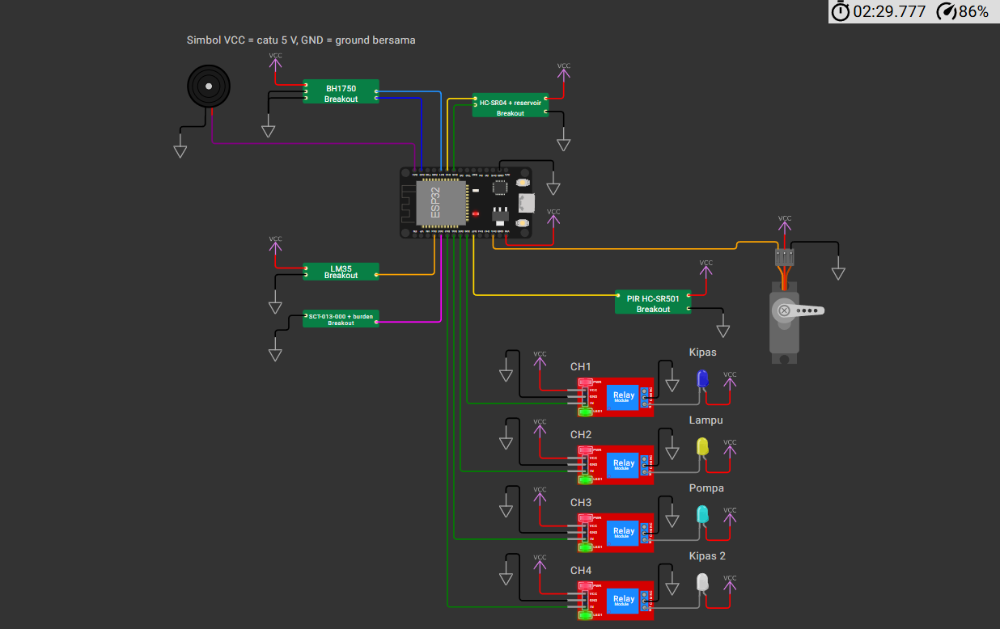
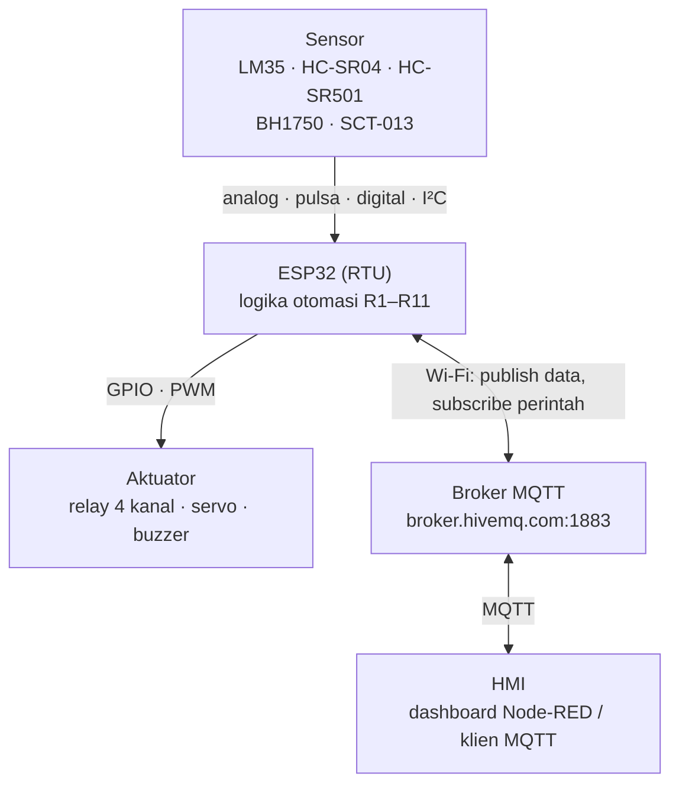
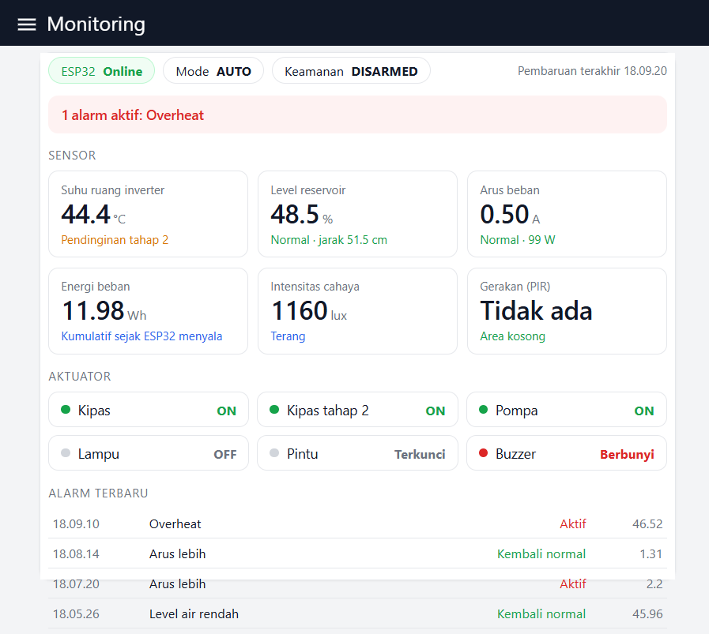
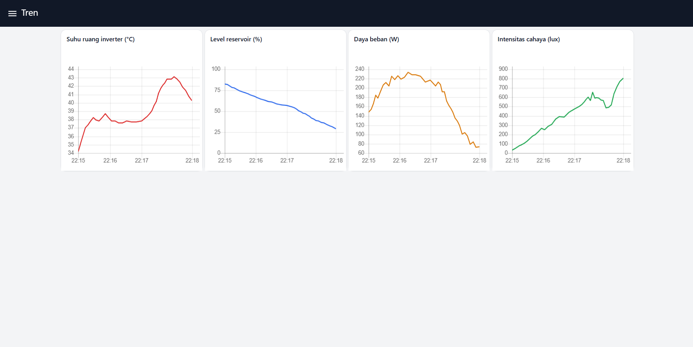

# Sistem Monitoring Lingkungan & Manajemen Keamanan Cerdas Berbasis IoT/SCADA pada Substation PLTS

Prototipe sistem monitoring dan keamanan untuk ruang kontrol/inverter Pembangkit Listrik Tenaga Surya (PLTS),
disimulasikan dengan **ESP32 di Wokwi** dan terhubung ke HMI melalui **MQTT**. ESP32 membaca lima sensor,
menjalankan 11 aturan otomasi secara lokal (pendinginan bertingkat, proteksi *overheat*, lampu otomatis,
pompa reservoir, alarm intrusi, kunci pintu servo), lalu mengirim data dan menerima perintah dari dashboard.

Tugas 2 mata kuliah *Sistem Komunikasi Bergerak dan Nirkabel*, Teknik Elektro, Universitas Pendidikan Indonesia (2026).



## Daftar isi

- [Fitur](#fitur)
- [Arsitektur](#arsitektur)
- [Komponen dan pin](#komponen-dan-pin)
- [Aturan otomasi R1–R11](#aturan-otomasi-r1r11)
- [Topik dan payload MQTT](#topik-dan-payload-mqtt)
- [Struktur folder](#struktur-folder)
- [Cara menjalankan](#cara-menjalankan)
- [Memantau dan mengendalikan sistem](#memantau-dan-mengendalikan-sistem)
- [Menguji aturan saat simulasi](#menguji-aturan-saat-simulasi)
- [Menjalankan di ESP32 fisik](#menjalankan-di-esp32-fisik)
- [Hasil pengujian](#hasil-pengujian)
- [Keterbatasan](#keterbatasan)
- [Penulis](#penulis)

## Fitur

- **Monitoring 5 sensor tiap 1 detik**, dikirim ke broker MQTT tiap 2 detik: suhu ruang inverter (LM35),
  level reservoir air pendingin (HC-SR04), gerakan (PIR HC-SR501), intensitas cahaya (BH1750),
  serta arus, daya, dan energi beban (SCT-013-000).
- **Pendinginan bertingkat dengan histeresis.** Kipas 1 menyala ≥ 35 °C dan mati ≤ 32 °C, kipas 2 menyala ≥ 40 °C,
  sehingga relay tidak berkedip di sekitar ambang dan energi pendingin lebih hemat.
- **Proteksi *overheat* (R4).** Pada suhu ≥ 45 °C kedua kipas dipaksa menyala dan buzzer berbunyi, **termasuk di mode MANUAL**.
  Perintah operator untuk mematikan kipas saat itu ditolak (`OVERRIDE_R4`).
- **Keamanan area terbatas.** Saat `ARMED`, gerakan memicu alarm `INTRUSI`, buzzer, dan pintu dikunci.
  Pintu hanya bisa dibuka dari HMI saat `DISARMED`, lalu terkunci otomatis lagi setelah 10 detik.
- **Lampu otomatis** menyala saat ada gerakan dan mati 30 detik setelah gerakan terakhir.
- **Pompa reservoir otomatis**: menyala saat level < 20 % dan berhenti saat level ≥ 80 %.
- **Mode AUTO/MANUAL.** Di mode MANUAL, keempat relay dikendalikan dari HMI. Perintah relay saat mode AUTO ditolak (`MODE_AUTO`).
- **Konfirmasi perintah (ack).** Setiap perintah membawa `id` dan dibalas `ack` setelah aktuator berubah,
  sehingga HMI dapat mengukur waktu respon pulang-pergi tanpa sinkronisasi jam.
- **Koneksi tangguh.** Wi-Fi dicoba ulang tiap 10 s dan MQTT tiap 3 s tanpa menghentikan logika otomasi.
  MQTT *Last Will* (`online = 0`) memberi tahu HMI ketika ESP32 terputus.
- **5 custom chip Wokwi** (ditulis dalam C) untuk sensor yang tidak tersedia atau tidak bisa diotomasi di Wokwi,
  masing-masing dengan slider nilai dan **mode skenario** yang mengubah nilai sensor sendiri selama simulasi.

## Arsitektur



Logika otomasi berjalan di ESP32, bukan di HMI, supaya proteksi tetap bekerja walaupun koneksi jaringan putus.

| Dashboard Monitoring | Dashboard Tren |
|---|---|
|  |  |

Screenshot di atas berasal dari dashboard Node-RED yang dipakai saat pengujian. *Flow* Node-RED-nya **tidak termasuk** dalam repositori ini.
Repositori ini berisi sisi perangkat (firmware dan rangkaian simulasi).

## Komponen dan pin

| Komponen | Fungsi | Pin ESP32 | Sinyal |
|---|---|---|---|
| LM35 | Suhu ruang inverter | GPIO34 (ADC1_CH6) | Analog, 10 mV/°C |
| SCT-013-000 + burden 22 Ω + bias 1,65 V | Arus beban AC | GPIO35 (ADC1_CH7) | Analog AC, dihitung RMS |
| HC-SR04 | Jarak permukaan air → level reservoir | TRIG GPIO18, ECHO GPIO19 | Pulsa digital |
| HC-SR501 (PIR) | Deteksi gerakan | GPIO27 | Digital HIGH/LOW |
| BH1750 | Intensitas cahaya (lux) | SDA GPIO21, SCL GPIO22 | I²C, alamat 0x23 |
| Relay CH1 / CH2 / CH3 / CH4 | Kipas / lampu / pompa / kipas tahap 2 | GPIO26 / 25 / 33 / 32 | Digital, aktif LOW |
| Servo SG90 | Kunci pintu (0° terkunci, 90° terbuka) | GPIO13 | PWM 50 Hz |
| Buzzer aktif | Alarm | GPIO23 | Digital |
| LED onboard | Indikator Wi-Fi + MQTT tersambung | GPIO2 | Digital |

Sensor analog sengaja dipasang di ADC1 karena kanal ADC2 tidak bisa dibaca saat Wi-Fi aktif.

## Aturan otomasi R1–R11

| ID | Kondisi | Aksi |
|---|---|---|
| R1 | Suhu ≥ 35 °C | Kipas CH1 ON |
| R2 | Suhu ≤ 32 °C | Kipas CH1 OFF (histeresis 3 °C) |
| R3 | Suhu ≥ 40 °C / ≤ 37 °C | Kipas tahap 2 (CH4) ON / OFF |
| R4 | Suhu ≥ 45 °C (reda ≤ 43 °C) | Kedua kipas dipaksa ON, buzzer, alarm `OVERHEAT`; aktif di mode AUTO maupun MANUAL |
| R5 | PIR mendeteksi gerakan | Lampu CH2 ON, mati 30 s setelah gerakan terakhir |
| R6 | Gerakan saat `ARMED` | Alarm `INTRUSI`, buzzer, pintu dikunci; reda 30 s setelah gerakan terakhir |
| R7 | Perintah buka pintu saat `DISARMED` | Servo 90°, terkunci otomatis setelah 10 s; ditolak saat `ARMED` |
| R8 | Level reservoir < 20 % | Pompa CH3 ON + alarm `LEVEL_RENDAH` |
| R9 | Level reservoir ≥ 80 % | Pompa CH3 OFF |
| R10 | — | Monitoring cahaya (lux sebagai proksi penyinaran) |
| R11 | Arus > 2 A | Alarm `ARUS_LEBIH` |

Mode **AUTO** menjalankan R1–R11. Mode **MANUAL** menyerahkan keempat relay ke operator, kecuali R4 yang selalu aktif.
Status keamanan `ARMED`/`DISARMED` diatur terpisah dari mode operasi.

## Topik dan payload MQTT

Broker: `broker.hivemq.com:1883`. Semua topik memakai prefiks `pltsiot/2300118/` (lihat `TOPIC_PREFIX` di `PLTS/PLTS.ino`).

| Topik | Arah | Contoh isi |
|---|---|---|
| `…/sensor` | ESP32 → HMI, tiap 2 s | `{"temp":29.06,"dist":51.5,"level":48.5,"pir":0,"lux":1160.0,"irms":0.501,"power":99.3,"energy":0.2097,"uptime":10}` |
| `…/status` | ESP32 → HMI, saat berubah atau tiap 10 s (retain) | `{"mode":"AUTO","arm":"ARMED","fan":0,"lamp":0,"pump":1,"fan2":0,"door":"LOCKED","buzzer":0,"overheat":0,"intrusi":0,"levelLow":0,"overCurrent":0}` |
| `…/alarm` | ESP32 → HMI, saat alarm berubah | `{"type":"OVERHEAT","active":1,"value":46.52,"uptime":38}` |
| `…/online` | ESP32 → HMI (retain, Last Will) | `1` saat tersambung, `0` saat putus |
| `…/ack` | ESP32 → HMI | `{"id":1,"done":1,"reason":"OK"}` |
| `…/cmd/mode` | HMI → ESP32 | `AUTO` atau `MANUAL` |
| `…/cmd/arm` | HMI → ESP32 | `ARMED` atau `DISARMED` |
| `…/cmd/relay` | HMI → ESP32 | `{"ch":1,"state":1,"id":1}` (hanya di mode MANUAL) |
| `…/cmd/door` | HMI → ESP32 | `{"action":"OPEN","id":2}` atau `{"action":"LOCK","id":3}` |

Nilai `reason` pada `ack`: `OK`, `MODE_AUTO` (relay ditolak di mode AUTO), `OVERRIDE_R4` (kipas tidak boleh dimatikan saat *overheat*),
`ARMED` (pintu tidak boleh dibuka saat ARMED), dan `ACTION_INVALID`.

Library PubSubClient hanya dapat *publish* dengan QoS 0, sedangkan *subscribe* perintah memakai QoS 1.

## Struktur folder

```text
.
├── PLTS/
│   ├── PLTS.ino                      # Firmware ESP32
│   └── build/
│       ├── PLTS.ino.merged.bin       # Firmware hasil kompilasi (dipakai Wokwi for VS Code)
│       └── PLTS.ino.elf
├── diagram.json                      # Rangkaian Wokwi: ESP32, 5 sensor, 4 relay + LED beban, servo, buzzer
├── wokwi.toml                        # Konfigurasi Wokwi for VS Code (firmware + 5 custom chip)
├── libraries.txt                     # Library untuk wokwi.com: PubSubClient, ArduinoJson
├── lm35.chip.c / .json / .wasm       # Custom chip LM35 (slider suhu, 10 mV/°C)
├── bh1750.chip.c / .json / .wasm     # Custom chip BH1750 (I²C 0x23, slider lux)
├── sct013.chip.c / .json / .wasm     # Custom chip SCT-013-000 + burden 22 Ω + bias 1,65 V (gelombang 50 Hz)
├── reservoir.chip.c / .json / .wasm  # Custom chip HC-SR04 + model tangki air 100 cm
├── pir.chip.c / .json / .wasm        # Custom chip PIR HC-SR501
├── wokwi-api.h                       # Header API custom chip Wokwi
├── build.ps1                         # Skrip kompilasi ulang firmware (dan custom chip)
├── PANDUAN_WOKWI.md                  # Panduan rinci langkah demi langkah
└── docs/                             # Gambar untuk README
```

## Cara menjalankan

### Pilihan A: Wokwi for VS Code (disarankan)

Firmware dan kelima custom chip sudah dikompilasi di repositori ini, jadi simulasi bisa langsung dijalankan.

1. Pasang [Visual Studio Code](https://code.visualstudio.com/) dan ekstensi **Wokwi Simulator** (penerbit: Wokwi).
2. Clone repositori ini:

   ```bash
   git clone https://github.com/chaka-ranchaka/Sistem-Monitoring-Lingkungan-Manajemen-Keamanan-Cerdas-Berbasis-IoT-SCADA-pada-Substation-PLTS.git
   ```

3. Di VS Code, tekan **F1** → **Wokwi: Request a new License**, login di browser, lalu setujui. Lisensi gratis untuk penggunaan pribadi/edukasi.
4. **File → Open Folder…** → pilih folder hasil clone (folder yang berisi `wokwi.toml`).
5. Buka `diagram.json`, lalu tekan **F1** → **Wokwi: Start Simulator**. Biarkan tab simulator tetap terlihat, karena simulasi berhenti bila tab ditutup.
6. Cek Serial Monitor. Harus muncul `Wi-Fi connect... OK`, `MQTT connect... OK`, lalu satu baris JSON sensor tiap 2 detik.
   LED onboard (GPIO2) menyala saat Wi-Fi dan MQTT tersambung. Baris `MQTT connect... gagal, rc=-2` di awal itu normal, karena ESP32 akan mencoba ulang.

Wi-Fi `Wokwi-GUEST` dan akses internet ke broker berjalan lewat gateway bawaan ekstensi, jadi tidak perlu pengaturan jaringan.

### Pilihan B: wokwi.com di browser

1. Login di [wokwi.com](https://wokwi.com) → **New Project** → **ESP32** (template Arduino).
2. **Tambahkan file custom chip lebih dulu**, sebelum mengganti `diagram.json`. Klik **▾** di sebelah tab file → **New file…**, lalu buat
   `lm35.chip.json`, `lm35.chip.c`, `bh1750.chip.json`, `bh1750.chip.c`, `sct013.chip.json`, `sct013.chip.c`,
   `reservoir.chip.json`, `reservoir.chip.c`, `pir.chip.json`, dan `pir.chip.c`, dengan isi dari repositori ini. Nama file harus persis sama.
3. Buat `libraries.txt` berisi dua baris: `PubSubClient` dan `ArduinoJson`.
4. Ganti isi `diagram.json` dengan `diagram.json` dari repositori ini, dan ganti `sketch.ino` dengan isi `PLTS/PLTS.ino`.
5. Simpan (Ctrl+S) lalu klik **▶ Start**. Kompilasi pertama lebih lama karena custom chip dan library ikut dikompilasi.

Langkah yang lebih rinci, beserta catatan teknisnya, ada di [PANDUAN_WOKWI.md](PANDUAN_WOKWI.md).

### Mengganti prefiks topik

Broker HiveMQ bersifat publik, jadi siapa pun dapat membaca dan mengirim ke topik yang sama.
Jika menjalankan salinan sendiri, ganti prefiks di `PLTS/PLTS.ino` dengan kode unik:

```cpp
#define TOPIC_PREFIX "pltsiot/2300118/"   // ganti 2300118 dengan kode unikmu
```

Setelah mengubah `PLTS.ino`, firmware harus dikompilasi ulang (lihat bagian berikut) jika memakai Wokwi for VS Code.

### Kompilasi ulang firmware

Dibutuhkan [Arduino CLI](https://arduino.github.io/arduino-cli/), ESP32 core, dan dua library. Pada Windows:

```powershell
winget install ArduinoSA.CLI
arduino-cli core update-index
arduino-cli core install esp32:esp32
arduino-cli lib install PubSubClient ArduinoJson
powershell -ExecutionPolicy Bypass -File build.ps1
```

`build.ps1` menghasilkan `PLTS/build/PLTS.ino.merged.bin` yang dibaca `wokwi.toml`. Proyek ini diuji dengan ESP32 Arduino core 3.3.11 dan ArduinoJson 7.

Custom chip hanya perlu dikompilasi ulang jika file `.chip.c` diubah: jalankan `build.ps1 -Chips` (membutuhkan `wokwi-cli` di PATH).

## Memantau dan mengendalikan sistem

Tanpa dashboard Node-RED, sistem tetap bisa dipantau dan dikendalikan dengan klien MQTT apa pun, misalnya
[HiveMQ WebSocket Client](https://www.hivemq.com/demos/websocket-client/):

1. Klik **Connect** dengan pengaturan bawaan.
2. **Subscribe** ke `pltsiot/2300118/#` untuk melihat semua data, status, alarm, dan ack.
3. **Publish** perintah, misalnya:

| Topik | Pesan | Hasil |
|---|---|---|
| `pltsiot/2300118/cmd/arm` | `DISARMED` | Alarm intrusi nonaktif |
| `pltsiot/2300118/cmd/door` | `{"action":"OPEN","id":2}` | Pintu terbuka 10 s, lalu terkunci lagi |
| `pltsiot/2300118/cmd/mode` | `MANUAL` | Relay dikendalikan operator |
| `pltsiot/2300118/cmd/relay` | `{"ch":1,"state":1,"id":1}` | Kipas CH1 menyala |
| `pltsiot/2300118/cmd/mode` | `AUTO` | Kembali ke otomasi R1–R11 |

## Menguji aturan saat simulasi

Di `diagram.json`, slider **Mode skenario** kelima custom chip diset ke **1 (otomatis)**, sehingga nilai sensor berubah sendiri:

| Sensor | Pola skenario (waktu simulasi) | Aturan yang terpicu |
|---|---|---|
| LM35 | Suhu 23–43 °C, siklus 4 menit; lonjakan sekitar 50 °C tiap 6 menit | R1–R3, R4 `OVERHEAT` |
| Reservoir (HC-SR04) | Level turun 85 → 15 % selama 100 s, naik lagi ke 85 % selama 50 s | R8, R9 |
| PIR | Orang lewat tiap 20–60 s, sinyal HIGH 4–8 s | R5, R6 `INTRUSI` saat ARMED |
| BH1750 | Kurva siang 0 → ±1100 → 0 lux (siklus 4 menit) + awan acak | R10 |
| SCT-013 | Arus 0,3–1,2 A (siklus 2 menit); lonjakan 2,6 A tiap 6 menit | R11 `ARUS_LEBIH` |

Simulasi berjalan lebih lambat dari waktu nyata, sehingga semua kejadian di atas biasanya muncul dalam ±25 menit waktu nyata.

Untuk uji manual, klik chip yang diuji, geser **Mode skenario** ke **0**, lalu pakai slider nilainya:

| Uji | Cara | Hasil yang diharapkan |
|---|---|---|
| R1/R2 | LM35 ke 36 °C, lalu 31 °C | LED Kipas menyala, lalu padam (tetap menyala di 33–34 °C karena histeresis) |
| R3 | LM35 ke 41 °C | LED Kipas 2 ikut menyala |
| R4 | LM35 ke 46 °C | Buzzer berbunyi, alarm `OVERHEAT` |
| R5/R6 | Slider "Gerakan" PIR ke 1, lalu 0 | Lampu menyala 30 s; saat ARMED muncul alarm `INTRUSI` |
| R8/R9 | Jarak reservoir ke 90 cm (level 10 %), lalu 15 cm (level 85 %) | LED Pompa menyala, lalu padam |
| R11 | SCT-013 ke 3 A | Alarm `ARUS_LEBIH` |

## Menjalankan di ESP32 fisik

Firmware yang sama dapat dipakai di ESP32 DevKit V1 dengan beberapa penyesuaian:

1. Ubah `#define SIMULASI_WOKWI 1` menjadi `0`. Wokwi memodelkan ADC secara linear dengan referensi 5 V,
   sedangkan pada ESP32 asli firmware memakai `analogReadMilliVolts()` yang terkalibrasi eFuse.
2. Isi `WIFI_SSID` dan `WIFI_PASS` dengan jaringan Wi-Fi yang dipakai.
3. Tambahkan rangkaian yang tidak dimodelkan di simulasi:
   - **pembagi tegangan 1 kΩ/2 kΩ** pada pin ECHO HC-SR04 (5 V → 3,33 V);
   - **resistor burden 22 Ω** dan **bias 1,65 V** (pembagi 2 × 10 kΩ + kapasitor 10 µF) untuk SCT-013-000;
   - **transistor NPN** (S8050/2N2222, R basis 1 kΩ) untuk buzzer;
   - modul relay 4 kanal dengan jumper **JD-VCC dilepas**: JD-VCC ke 5 V, VCC ke 3,3 V.
4. Pakai catu daya 5 V 2 A dengan ground bersama. Servo dan koil relay dapat menarik arus puncak sekitar 1 A.

## Hasil pengujian

Ringkasan pengujian pada simulasi Wokwi (12 Oktober 2026):

| Pengujian | Hasil |
|---|---|
| Aturan otomasi R1–R11 | 11 dari 11 berhasil, termasuk R4 di mode MANUAL dan penguncian ulang pintu R7 |
| Galat pembacaan sensor terhadap nilai slider | Maksimum 0,67 % (LM35 0,21 %, HC-SR04 0,56 %, BH1750 0,13 %, SCT-013 0,67 %) |
| Waktu respon perintah (pulang-pergi, n = 30) | 634 ± 182 ms, 30 dari 30 berhasil |
| Keandalan koneksi | Sambung ulang otomatis 3 dari 3; ESP32 putus terdeteksi lewat Last Will dalam ±22 s |
| Energi pendingin | Kendali kipas bertingkat menghemat 62,2 % dibanding kipas yang selalu menyala (asumsi daya kipas 25 W) |

## Keterbatasan

- Semua hasil berasal dari simulasi. Custom chip menghasilkan sinyal ideal tanpa derau, sehingga galat di atas hanya menguji rumus konversi di firmware, bukan akurasi sensor fisik.
- Broker MQTT publik dipakai tanpa autentikasi dan enkripsi. Untuk pemakaian nyata, gunakan broker lokal dengan TLS dan autentikasi.
- SCT-013-000 hanya mengukur arus AC, dan daya dihitung dengan asumsi tegangan 220 V serta faktor daya 0,9.
- BH1750 mengukur iluminansi (lux), bukan iradiansi matahari (W/m²), sehingga hanya dipakai sebagai proksi kondisi penyinaran.
- Waktu respon dipengaruhi koneksi internet ke broker publik dan kecepatan simulator yang lebih lambat dari waktu nyata.
